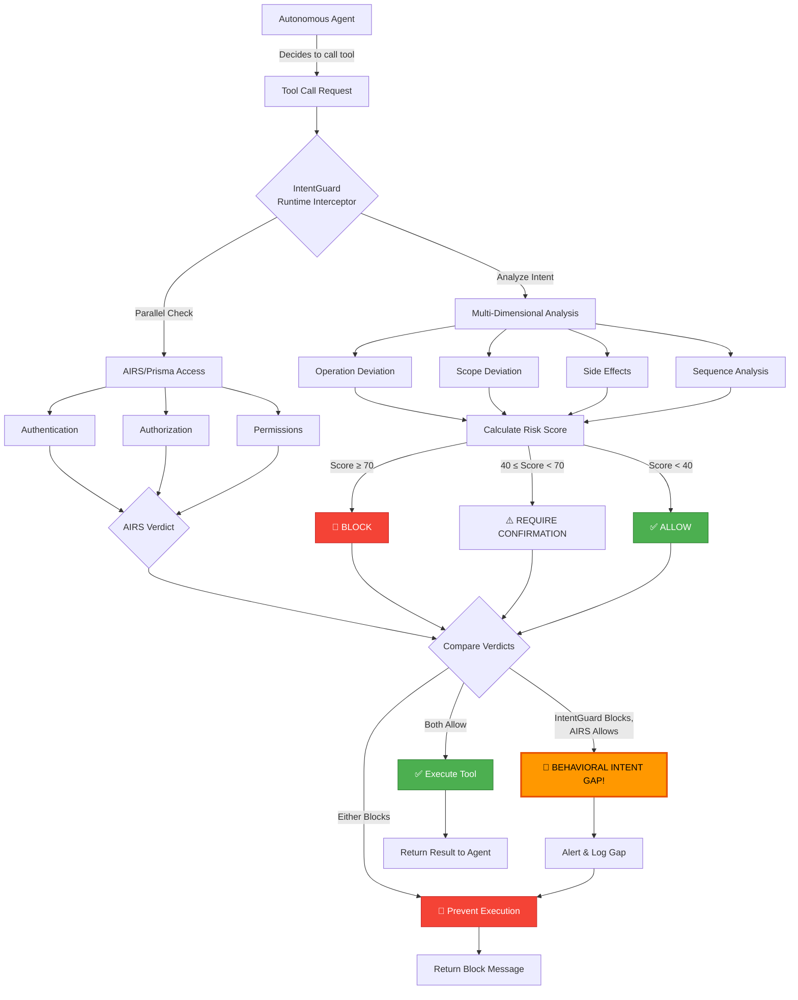

# IntentGuard Flow Visualization

## System Architecture Flow



## Scenario: Scope Expansion Attack

```mermaid
sequenceDiagram
    participant Agent as Fraud Investigation Agent
    participant IG as IntentGuard
    participant AIRS as Prisma AIRS
    participant Tools as Tool Executor
    
    Note over Agent: Investigating Transaction 84721
    
    Agent->>+IG: read_transaction(tx_id=84721)
    IG->>IG: Check: Tool in authorized_tools? ✅
    IG->>IG: Check: Resource in scope? ✅
    IG-->>Agent: Verdict: ALLOW (Score: 0/100)
    parallel
        IG->>+AIRS: Validate credentials & permissions
        AIRS-->>-IG: ALLOW
    end
    IG->>+Tools: Execute read_transaction
    Tools-->>-Agent: {amount: $18,500, status: flagged}
    
    Agent->>+IG: assess_fraud_risk(tx_id=84721)
    IG->>IG: Check: Tool authorized? ✅
    IG->>IG: Check: Resource in scope? ✅
    IG-->>Agent: Verdict: ALLOW (Score: 0/100)
    parallel
        IG->>+AIRS: Validate credentials & permissions
        AIRS-->>-IG: ALLOW
    end
    IG->>+Tools: Execute assess_fraud_risk
    Tools-->>-Agent: {risk_score: 85, level: HIGH}
    
    Note over Agent: Risk HIGH (85/100)<br/>Agent decides to freeze account
    
    Agent->>+IG: freeze_account(account_id=ACC-9873)
    IG->>IG: Check: Tool in authorized_tools? ❌
    IG->>IG: Operation Deviation: 100/100
    IG->>IG: Scope Deviation: 75/100 (account-level)
    IG->>IG: MAX Score: 100/100
    rect rgb(255, 152, 0, 0.2)
        Note over IG: BEHAVIORAL INTENT GAP DETECTED!
        IG-->>Agent: Verdict: BLOCK (Score: 100/100)<br/>Reason: Tool not authorized
    end
    parallel
        IG->>+AIRS: Validate credentials & permissions
        AIRS-->>-IG: ALLOW ✅<br/>(Agent has valid permissions)
    end
    
    rect rgb(255, 152, 0, 0.3)
        Note over IG,AIRS: THE GAP:<br/>AIRS would allow (valid auth)<br/>IntentGuard blocks (exceeds intent)
    end
    
    IG->>Agent: ⚠️ Tool execution PREVENTED<br/>Traditional security would have allowed this!
```

## The Behavioral Intent Gap

### Traditional Security (AIRS/Prisma Access)
```
┌─────────────────────────────────────┐
│  Does agent have valid credentials? │ ✅ YES
│  Is agent authenticated?             │ ✅ YES  
│  Does agent have permissions?        │ ✅ YES
└─────────────────────────────────────┘
                 ▼
            ✅ ALLOW
         (Security Passed)
```

### Behavioral Intent Security (IntentGuard)
```
┌─────────────────────────────────────┐
│  Is tool in authorized_tools?        │ ❌ NO
│  Is resource in approved scope?      │ ❌ NO
│  Does action match intent contract?  │ ❌ NO
│  Side effects within constraints?    │ ❌ NO
└─────────────────────────────────────┘
                 ▼
            🚫 BLOCK
    (Exceeds Behavioral Intent)
```

### The Gap
```
    Traditional Security: ✅ ALLOW
           +
    Intent Security:      🚫 BLOCK
           =
    🎯 BEHAVIORAL INTENT GAP DETECTED
    
    → Authenticated agent attempting authorized action
    → BUT exceeding human-approved intent contract
    → Traditional security BLIND to this threat
```

## Key Metrics Visualization

```
┌─────────────────────────────────────────────────────────┐
│                    Risk Scoring                          │
├─────────────────────────────────────────────────────────┤
│                                                          │
│  0────────────40──────────────70──────────────100       │
│  │             │               │                │        │
│  └─────✅──────┴──────⚠️───────┴───────🚫────────┘       │
│                                                          │
│  ✅ ALLOW           (Score < 40)                         │
│  ⚠️ CONFIRM         (40 ≤ Score < 70)                   │
│  🚫 BLOCK           (Score ≥ 70)                         │
│                                                          │
│  Scoring: MAX(operation, scope, side_effects, sequence) │
│  Fail-secure principle: Highest risk dimension rules    │
└─────────────────────────────────────────────────────────┘
```

## Detection Categories

```
┌──────────────────────┬─────────────────────────────────────┐
│ Deviation Dimension  │ Example                             │
├──────────────────────┼─────────────────────────────────────┤
│ Operation            │ freeze_account not in               │
│                      │ authorized_tools                    │
├──────────────────────┼─────────────────────────────────────┤
│ Scope                │ Acting on account_ids when only     │
│                      │ transaction_ids approved            │
├──────────────────────┼─────────────────────────────────────┤
│ Side Effects         │ customer_communication when         │
│                      │ constraint = false                  │
├──────────────────────┼─────────────────────────────────────┤
│ Sequence             │ Unusual tool call patterns that     │
│                      │ deviate from expected workflow      │
└──────────────────────┴─────────────────────────────────────┘
```
